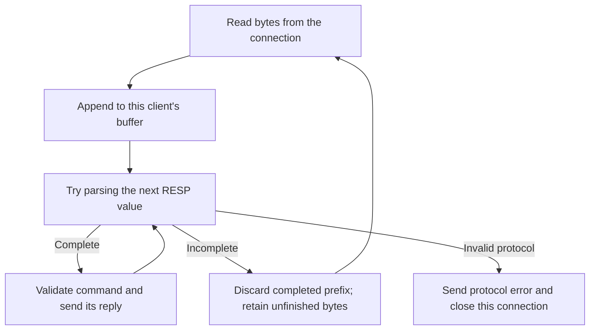
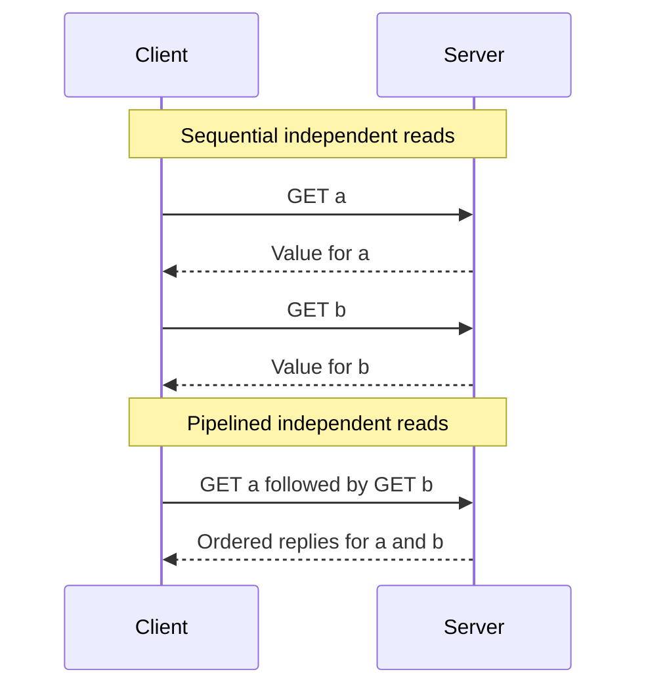
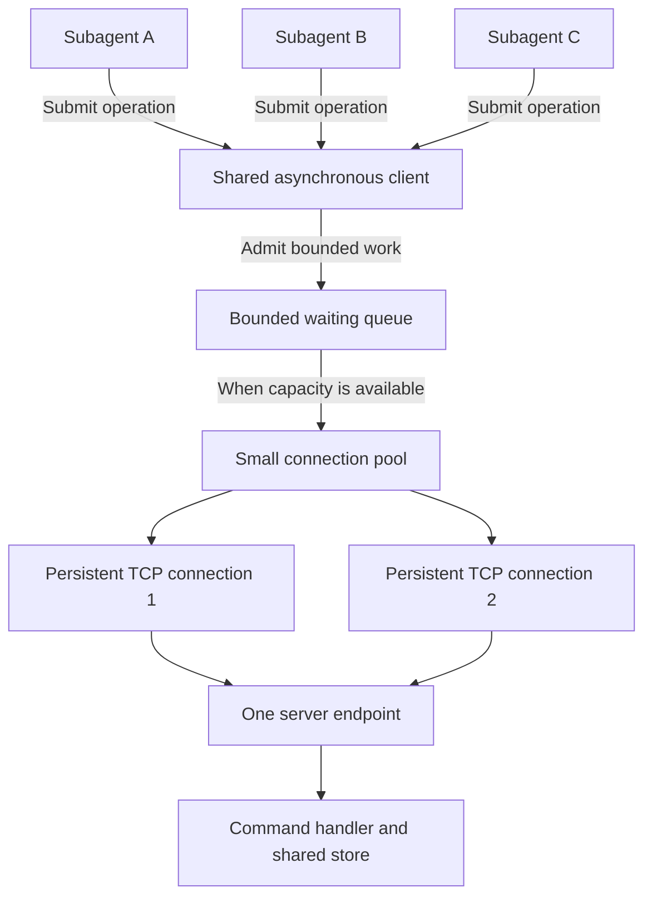
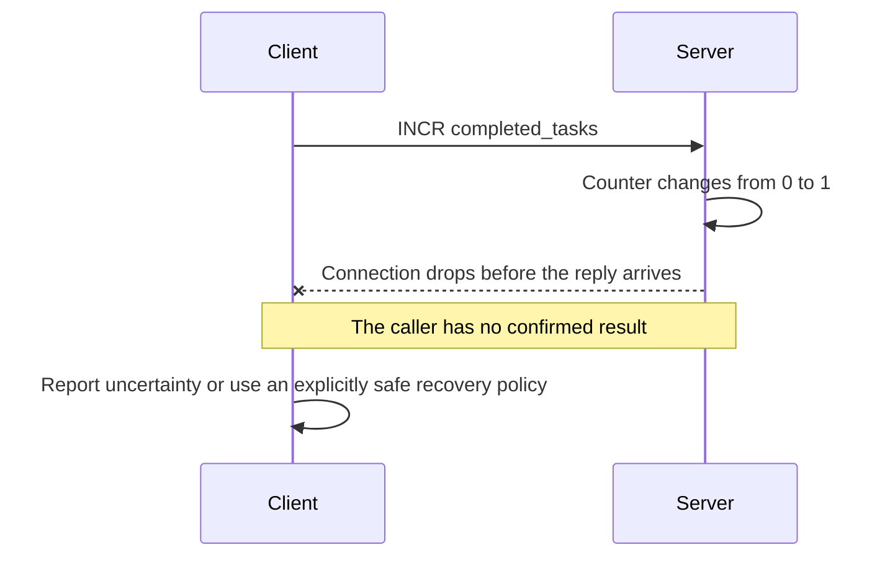
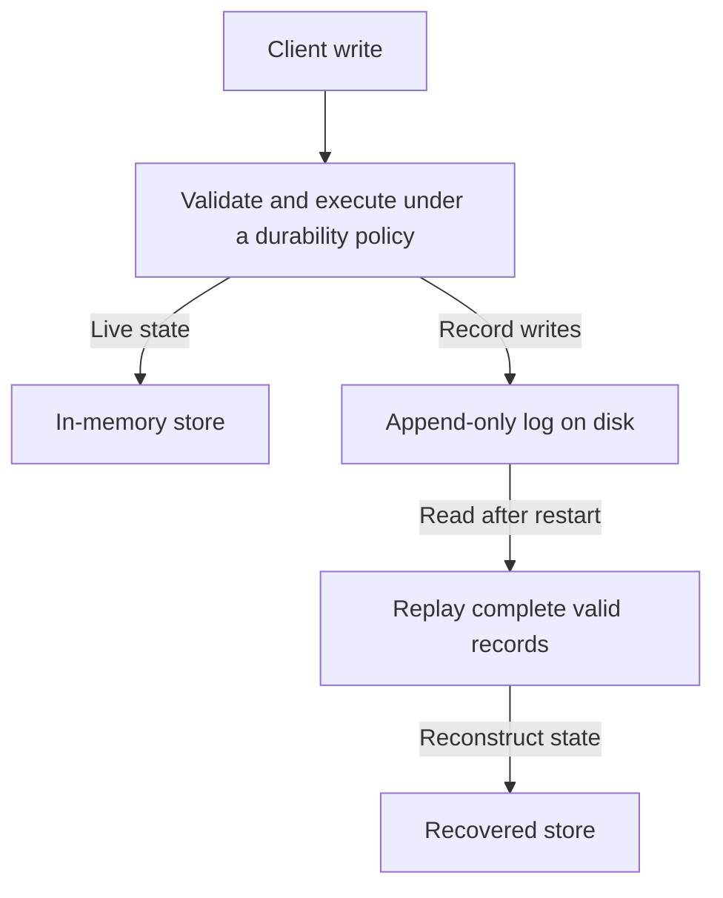
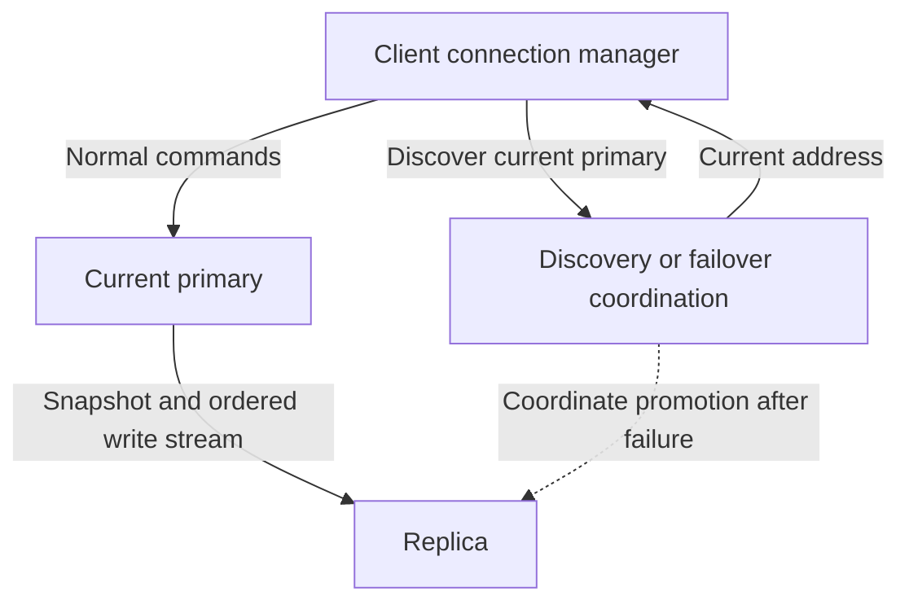

# Feature explanations and learning guide

Use this guide to understand the [roadmap](ROADMAP.md), choose a small piece of work, and know what completing it will let you do. The [documentation overview](README.md) describes the current implementation. Except where explicitly labeled current behavior, the designs below are proposed capabilities to build and verify.

## Decoder and server

Related work: [milestone 1](ROADMAP.md#1-understand-and-strengthen-the-decoder-and-server).

The encoder turns value objects into bytes. The decoder reads bytes and reconstructs those values. A command is an array of bulk strings: its first item is the command name and the remaining items are arguments. The server then checks whether that decoded value is a valid command.

### Current decoder structure

The decoder uses composition: `RESPParser` creates and owns a `ByteReader`. Each class has its own file and responsibility.

| File | Responsibility |
| --- | --- |
| [byte_reader.py](../src/redis_python/protocols/byte_reader.py) | Own the input bytes and cursor; read a CRLF-terminated line or an exact byte count; save and restore positions |
| [parser.py](../src/redis_python/protocols/parser.py) | Interpret prefixes, numeric headers, string formats, and nested arrays |
| [values.py](../src/redis_python/protocols/values.py) | Represent the decoded values and encode them back into RESP bytes |

Start reading at `RESPParser.parse()`. It saves a position, then calls `_parse_value()`, which consumes one prefix and selects a small method for that type. The methods are `_parse_simple_string()`, `_parse_error()`, `_parse_integer_value()`, `_parse_bulk_string()`, and `_parse_array()`.

The reader returns raw bytes: `read_line()` can return `b"5"`; the parser converts that into an integer when interpreting a length. The reader advances only after a successful read. If a later read fails, earlier successful reads have already advanced it, so `parse()` uses `reset()` to restore the position saved before the whole value. That includes partially parsed nested arrays.

There is only one cursor. The read-only `parser.cursor` property returns `reader.cursor`, and `parser.data` returns the reader's input bytes. Existing server code can inspect progress without managing a second position.

### Follow a command through the current decoder

The command `GET name` is represented by these 23 bytes. The backslash sequences below represent carriage return and line feed bytes.

```text
*2\r\n$3\r\nGET\r\n$4\r\nname\r\n
```

| Bytes | Meaning | Cursor after this part is complete |
| --- | --- | --- |
| `*2\r\n` | Array containing two values | 4, ready to parse the first item |
| `$3\r\nGET\r\n` | Bulk string containing three bytes, `GET` | 13 |
| `$4\r\nname\r\n` | Bulk string containing four bytes, `name` | 23 |

An array reuses the value parser for each item. This is recursion: parsing an array means parsing the values inside it, which may themselves be arrays. A planned nesting limit will keep that work bounded.

Suppose TCP delivers the first ten bytes and then the remaining thirteen:

```text
First read:  *2\r\n$3\r\nGE
Second read: T\r\n$4\r\nname\r\n
```

The first read is incomplete. `RESPParser.parse()` restores the cursor to the start of this value, which is zero in this example. The server retains those ten bytes. After appending the second read, it creates a parser over the combined buffer and obtains the complete command.

If an earlier command was already parsed, rollback returns to the start of the incomplete value, not the beginning of the whole buffer. The server can discard the completed prefix and retain the unfinished suffix. The current implementation reparses that suffix after more bytes arrive; a future incremental decoder could retain more internal progress if measurements justify it.

This flowchart describes the current parser/server interaction. Command validation occurs after a complete RESP value has been returned.



**Build next:** trace the separated parsing methods above, then add socket tests for every split position of representative commands. Parser unit tests already cover every split position of a binary `SET` command and rollback after an earlier complete value; the next step is verifying those behaviors through a real connection. Keep invalid protocol bytes distinct from an incomplete message and from a valid RESP value that is not a command.

**You can achieve:** understand and debug a complete request without guessing what one socket read contains. You also gain a tested foundation for batching, new clients, and other transports.

**Prove it:** one command split into pieces executes once; several complete commands produce the same number of ordered replies; a bad connection leaves another client's requests working. The source starting points are [parser.py](../src/redis_python/protocols/parser.py) and [server.py](../src/redis_python/server.py).

## Compatibility and measurement

Related work: [milestone 2](ROADMAP.md#2-establish-compatibility-and-performance-baselines).

Compatibility means matching a defined subset of Redis behavior: syntax, replies, errors, state changes, and relevant protocol handling. Pin the Redis version used as a reference and maintain a supported-command table. Supporting a handful of commands does not yet establish compatibility with every client library, which may send setup commands too.

Start by sending the same command sequences to the clone and reference Redis. Compare outcomes for absent keys, overwrites, duplicate keys, binary values, and invalid arguments. Record deliberate gaps instead of returning fake success for unsupported behavior.

### What pipelining changes

This proposed client behavior works with a server that accepts consecutive commands. Each diagram message abbreviates RESP bytes; a batch is not guaranteed to fit into one network packet or socket read.



Pipelining removes the requirement to wait between independent requests. It does not turn the commands into a transaction. If you need the result of `GET a` to construct your next command, that dependency still requires a wait.

**Build next:** a correctness-checking benchmark with sequential and pipelined modes. Keep the connection open in both modes. Measure connection setup separately if that is the question you want to answer.

**You can achieve:** distinguish command execution time, network waiting, decoding work, and queueing effects well enough to choose a useful optimization.

**Prove it:** record throughput and p50/p95/p99 latency alongside client count, value size, batch size, CPU, memory, and persistence settings. Percentiles describe the distribution: p99 is the latency at or below which 99 percent of the measured operations fall. Measure the whole operation, including queue waiting, and compare the same workload before and after a change.

## Standard storage features

Related work: [milestone 3](ROADMAP.md#3-add-standard-redis-storage-features).

The examples in this table are target capabilities. Many commands and options below are not implemented in v1 yet.

| Feature | What to implement | What you can build with it |
| --- | --- | --- |
| Counters | `INCR`, `DECR`, integer validation, overflow errors | Count tool calls or completed tasks with one atomic operation |
| Conditional writes | `SET` with `NX` or `XX` | Create a record only when absent, or update only when present |
| Expiration | `SET ... EX/PX`, `EXPIRE`, `TTL`, and related commands | Automatically make temporary session or cache entries unavailable after a deadline |
| Multi-key operations | `MGET`, `MSET` | Fetch or write several known keys in one command |
| Lists | Push, pop, length, and range commands | Store an ordered conversation or a basic nonblocking work queue |
| Hashes | Set, read, delete, and enumerate fields | Store user preferences or task state as fields of a record |

Start with counters and expiration while values are still strings. Then represent each stored value with a type so list operations cannot accidentally run on strings. Match Redis's `WRONGTYPE` behavior for invalid combinations.

For expiration, implement both removal on access and bounded cleanup of untouched expired keys. Tests should control time instead of waiting for real seconds. Preserve Redis rules such as `TTL` returning `-2` for a missing key and `-1` for a key without expiration; a plain replacing `SET` removes an existing expiry.

**Build next:** one command group at a time in [commands.py](../src/redis_python/commands.py) and [store.py](../src/redis_python/store.py), backed by state and compatibility tests.

**You can achieve:** a useful cache, session store, counter service, and conversation-history store from the same general database.

**Prove it:** compare command sequences with reference Redis. Also test concurrent `INCR` operations: each command must update the counter atomically. A separate `GET` followed by `SET` is a larger read-modify-write operation and can lose another caller's update without additional coordination.

## Concurrency pooling and backpressure

Related work: [milestone 4](ROADMAP.md#4-support-concurrent-clients-with-bounded-resource-use).

Concurrency lets several callers have work in progress, for example while one waits for a socket. Parallel execution means doing computations at the same time. Your current threads provide concurrent connection handling, while a shared lock permits one command handler call at a time.

An event loop is another way to schedule I/O. It can serve many waiting connections with fewer threads, but the effect on throughput and latency must be measured. Keep individual store commands atomic when changing this scheduling model.

This is a proposed design for several subagent tasks in one application process. It uses one server address and several reusable connections. Connections in the pool can initially serve one caller or pipeline at a time; independent callers sharing each connection is the later multiplexing milestone.



Replies travel back through the client to the requesting subagent. The client owns connection usage so callers cannot accidentally consume each other's replies.

Backpressure means slowing admission when capacity is full. Give the queue both a size limit and a wait deadline. Bound buffered bytes as well as request counts because a few large values can consume substantial memory. A slow response reader must also be prevented from creating an unlimited server-side output buffer.

**Build next:** connection reuse, a maximum pool size, acquisition deadlines, and bounded pipelines. Compare the existing server with an event-loop version under the same correctness tests and workload.

**You can achieve:** many subagents can submit work through a shared API while resource limits keep overload controlled. The server still processes all admitted operations; queueing changes where work waits.

**Prove it:** under a burst of callers, connections and memory remain within configured bounds, each reply reaches its owner, and overload ends in a defined wait or error. Separate processes normally need separate pools; a shared gateway is an additional service with its own queue, latency, and failure behavior.

## Connection recovery

Related work: [milestone 5](ROADMAP.md#5-recover-from-connection-failures).

A timeout limits how long a caller waits. Reconnection replaces an unusable socket. A retry sends an operation again. These mechanisms need separate rules because a failed connection does not reveal whether the server already executed a write.

This example illustrates an uncertain write outcome after the proposed `INCR` command exists:



Blindly resending this command can increment the counter twice. Retrying a read may be acceptable, but it can observe newer state. Document the policy callers receive. Exactly-once writes would need additional coordination or deduplication beyond ordinary RESP2 request/reply framing.

**Build next:** connection and command deadlines, cleanup of pending work, and limited reconnect attempts. Exponential backoff spaces attempts further apart; jitter adds randomness so many callers do not retry in lockstep.

**You can achieve:** temporary connection failures have bounded recovery and clear outcomes instead of indefinite waits or hidden duplicate writes.

**Prove it:** drop a connection before sending, during execution, and after execution but before the reply. Cancel or time out a request, then check that a late reply is drained correctly or the connection is discarded before reuse.

## Persistence and restart recovery

Related work: [milestone 6](ROADMAP.md#6-preserve-data-across-server-restarts).

The current dictionary disappears when the server process exits. An append-only log records writes on disk so startup can reconstruct state. This proposed diagram shows the live and recovery paths, not a particular ordering of logging, mutation, and acknowledgement.



Choose the acknowledgement policy explicitly. A policy that synchronizes each acknowledged write to disk trades additional I/O latency for a stronger durability promise. A policy that acknowledges before periodic synchronization permits loss of recent acknowledged writes after a crash. Test the policy actually implemented rather than assuming a successful file write means durable storage.

Expiration must survive recovery with its original deadline. If a key had one second remaining when the process stopped, replay must not grant it its original full lifetime again.

**Build next:** a replayable binary-safe log, defined write acknowledgement conditions, and crash tests. Add compaction after basic recovery works so the log does not grow forever.

**You can achieve:** restart the server and recover data covered by the durability policy, with documented behavior for truncated records, disk errors, and expired keys.

**Prove it:** terminate the process at controlled write stages, restart, and inspect values, types, and expiry. A disk log supports recovery on storage that remains available; surviving host or storage loss needs further redundancy.

## Multiplexing

Related work: [milestone 7](ROADMAP.md#7-experiment-with-multiplexing).

A pool reuses multiple connections. A multiplexer lets independent callers have requests outstanding on the same connection. A pool can contain multiplexed connections, provided one coordinator owns the writes, reads, and pending-call mapping for each connection.

For an ordinary RESP2 connection, a local queue can associate ordered replies with callers:

| Send position | Pending caller | Command | Matching ordinary reply |
| --- | --- | --- | --- |
| 1 | Subagent A | `GET user:42` | First reply |
| 2 | Subagent B | `SET task:7 running` | Second reply |
| 3 | Subagent C | `GET task:8` | Third reply |

These positions are local bookkeeping, not request IDs sent by standard RESP2. If caller A cancels after its command was sent, its reply still occupies the first position. Removing A's queue entry without consuming or discarding that reply would route all subsequent results incorrectly.

**Build next:** one connection with one coordinated writer, one reader, and pending-call records in send order. Bound outstanding bytes and requests. On disconnect, finish all affected pending calls with explicit failure or uncertain-outcome results.

**You can achieve:** independent callers share active connections without needing a separate connection for every outstanding request.

**Prove it:** interleave callers, cancellation, late responses, and reconnection without reply mismatches. Benchmark tail latency as well as throughput. A slow or blocking command can delay all following replies on a connection; give blocking commands, Pub/Sub, and transaction state dedicated connections if you add them.

## Languages and transports

Related work: [milestone 8](ROADMAP.md#8-learn-from-a-second-language-and-alternative-local-transport).

Language, message format, and transport are independent choices. Python, Go, or Rust can implement a client speaking RESP over TCP. Changing the transport does not by itself require changing the command handler or store.

| Experiment | First thing to build | Learning outcome |
| --- | --- | --- |
| Second language | Small Go or Rust RESP client and load generator | Interoperability, byte handling, and testing a shared protocol |
| Unix socket | Local listener using the same command path | Compare same-host communication with local TCP |
| Native decoder | A measured, separately built parser component with the Python parser as a reference | Language interfaces, packaging, and allocation costs |
| UDP extension | Datagram interface and custom client on a separate endpoint | Loss, reordering, duplication, request matching, and flow control |

**Build next:** the second-language client after the baseline. Keep Python as the understandable reference while you learn its behavior.

**You can achieve:** use multiple languages in one repository at a clear boundary, with the same behavior tested across implementations. Keep UDP as an optional custom extension because standard Redis clients use TCP or Unix sockets.

**Prove it:** compare correctness and performance under the same workload. A UDP experiment also needs loss, duplication, reorder, size-limit, and overload tests. Record the result even if persistent TCP with pipelining remains the best fit.

## Agent memory example

Related work: [milestone 9](ROADMAP.md#9-exercise-the-database-with-an-agent-memory-example).

The agent application chooses which context to save and retrieve. The database supplies general operations. Start with a simulated agent so the storage behavior can be tested without a model API.

| Example key | Proposed type | Purpose |
| --- | --- | --- |
| `user:42:preferences` | Hash | Named user preferences |
| `session:abc:messages` | List | Ordered conversation events |
| `session:abc:status` | Expiring string | Temporary session state |
| `agent:planner:tasks_completed` | Integer string | Atomic task counter |

These are application naming conventions. Prefixes organize keys; they do not enforce access control or automatically prevent concurrent updates to the same key.

**Build next:** save a message, read selected history for a later turn, and exercise multiple simulated subagents. Use expiration and restart recovery only after those database milestones work.

**You can achieve:** demonstrate conversation continuity, durable preferences, temporary working state, and a shared client under concurrent load.

**Prove it:** conversations remain ordered according to accepted command order, unrelated session keys remain separate, expiry behaves correctly, and the restart test recovers the promised data. Retrieval by meaning with embeddings and automatic summarization are separate application extensions.

## Replication and failover

Related work: [milestone 10](ROADMAP.md#10-explore-replication-and-failover-later).

Replication copies data to another server. Failover changes which server is authoritative for writes. A reconnecting client needs a way to discover that server. These are additional database capabilities beyond connection pooling.

This is a proposed topology for the later milestone. The diagram illustrates replication and discovery, not a complete primary-election protocol.



**Build next:** snapshot transfer, ordered write replication, progress offsets, and resynchronization. Define primary ownership and how an old primary loses write authority before implementing automatic promotion.

**You can achieve:** study how another server takes over and how much state it has received. The availability and data-loss guarantees depend on the acknowledgement, persistence, replication, and failover policies together. Redis's default asynchronous replication can lose acknowledged writes during failover.

**Prove it:** test server failure and network partitions, including an old primary returning after promotion. Check which writes survive and verify that clients route to the authoritative server. Sentinel interoperability requires its own protocol work and compatibility tests; adding a replica alone does not provide it.

## Choosing the next achievable result

Start with the decoder walkthrough and milestone 1's socket tests. A useful first result is being able to explain one request byte by byte and demonstrate that fragmented requests still execute correctly. Next, establish the baseline and add one standard command group.

The later goals are independent reasons to keep improving: a session store after expiration, conversation history after lists, bounded concurrent subagent access after pooling, recoverable memory after persistence, and a failover study after replication. Speed claims should come from repeatable measurements; checking off architecture features alone does not establish a particular capacity.

For protocol and Redis behavior references, see the [roadmap reference list](ROADMAP.md#references). Diagram syntax follows Mermaid's [flowchart](https://mermaid.js.org/syntax/flowchart.html) and [sequence diagram](https://mermaid.js.org/syntax/sequenceDiagram.html) documentation.
