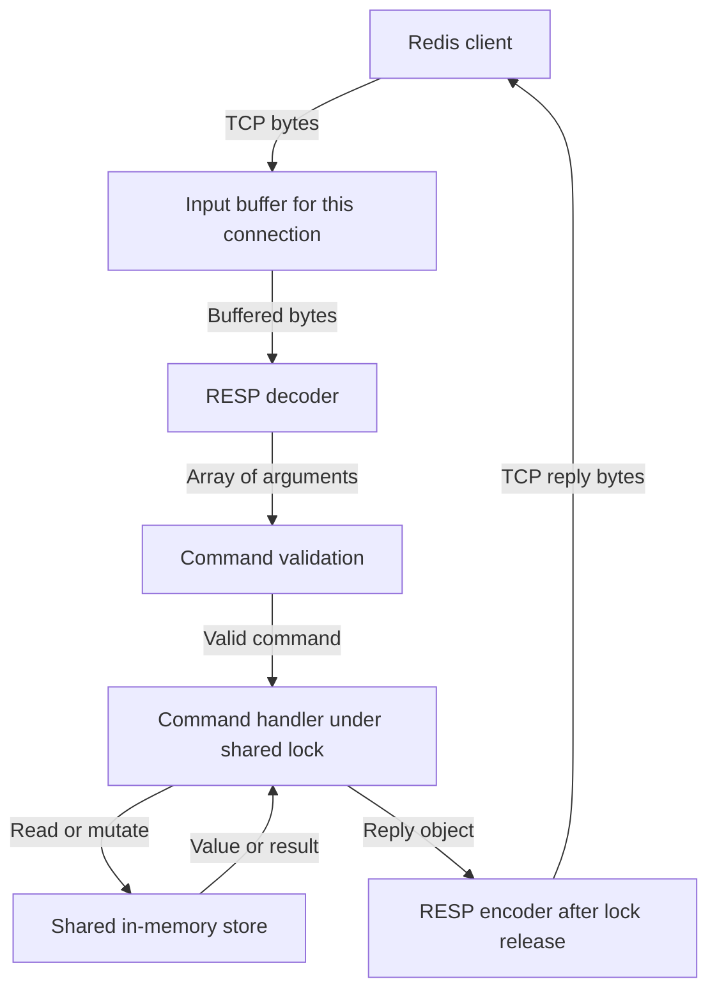

# Redis project documentation

Build this working Python Redis clone into a more complete Redis-compatible database, learn how its networking and storage work, and experiment with clients in other languages. AI agent memory is one application to build on top.

## Reading order

1. Start with the current architecture below to understand what already works.
2. Use the [feature roadmap](ROADMAP.md) to choose your next milestone and check off completed work.
3. Read the [feature explanations](FEATURES.md) for diagrams, examples, implementation starting points, and what each capability lets you achieve.

The diagrams use Mermaid and display in Mermaid-capable Markdown previews, including GitHub. The surrounding text explains the same behavior when a preview cannot render them. Current behavior and proposed designs are labeled separately.

## How v1 works

This diagram describes the current Python implementation. The return path shows a normal command reply; validation and protocol errors can return before reaching the store.



1. [The TCP server](../src/redis_python/server.py) accepts clients and collects incoming bytes in a buffer for each connection.
2. [The RESP decoder](../src/redis_python/protocols/parser.py) uses a [ByteReader](../src/redis_python/protocols/byte_reader.py) to turn complete messages into value objects. The reader owns the bytes and cursor; `parser.cursor` exposes that same position. If a message is incomplete, parsing restores the reader's position so those bytes can be kept until more arrive.
3. [The command handler](../src/redis_python/commands.py) interprets the command and its arguments. A shared lock currently allows one command to execute at a time across clients.
4. [The store](../src/redis_python/store.py) holds byte keys and byte values in a Python dictionary.
5. [The RESP value objects](../src/redis_python/protocols/values.py) encode the reply, which the server sends back to the client.

TCP delivers a stream of bytes. A command can arrive across multiple reads, and one read can contain multiple commands. The decoder determines where messages end; a socket read does not determine that boundary.

The server currently starts a thread for each connection. It supports multiple connected clients, but the command lock serializes changes to the shared store. There is no disk persistence or replication yet.

For example, `GET name` travels as RESP bytes, becomes an array containing `GET` and `name`, reads the dictionary, and produces an encoded bulk-string reply. The [decoder walkthrough](FEATURES.md#decoder-and-server) follows the cursor through those exact bytes.

## Where future features belong

| Component | Responsibilities |
| --- | --- |
| Protocol | Encode and decode RESP values, validate message structure, preserve incomplete input |
| Server | Accept connections, schedule I/O, manage buffers, apply connection limits, send replies |
| Command handler and store | Command semantics, data types, expiration, atomic operations, persistence |
| Client library | Connection pooling, pipelining, multiplexing, deadlines, reconnection, retry policy |
| Optional gateway | Share access across separate processes when measurements justify an extra service |

One server endpoint can accept many connections. A connection pool reuses a limited number of connections. Multiplexing allows several requests to be outstanding on one connection and routes replies to their callers. These are separate choices; an asynchronous API does not automatically provide multiplexing.

## Run the current project

From the repository root:

```bash
python3 -m src.redis_python.server
```

The current address is `localhost:1234`.

With `pytest` available, run the existing tests from the repository root:

```bash
python3 -m pytest -q
```

The baseline on 2026-11-01 was **80 passing tests**. These cover value objects, encoding, decoding, commands, and the store. TCP integration tests and performance benchmarks remain roadmap items.
