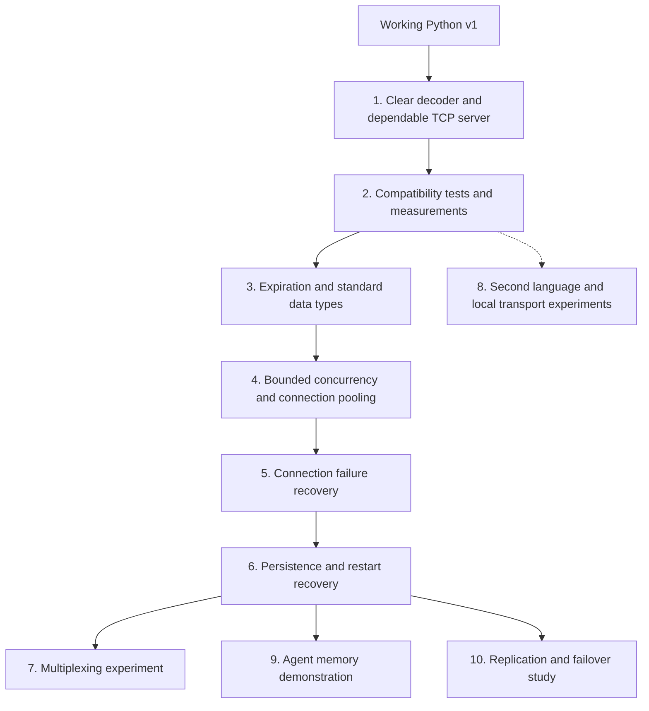

# Redis feature roadmap

Grow v1 into a Redis-compatible database with understandable internals, measured performance, and useful clients for concurrent applications. Keep standard Redis behavior as the foundation; use AI agent memory and transport experiments to exercise that foundation.

## Roadmap at a glance

The solid arrows show a suggested learning order. After dependable single-server recovery, multiplexing, an agent memory demo, and replication are separate follow-up projects. The dashed branch is an optional second-language experiment that can start once you have a baseline.

| Milestone | What you do | What you can achieve |
| --- | --- | --- |
| [1. Decoder and server](FEATURES.md#decoder-and-server) | Trace bytes, simplify parsing, test real socket behavior | Understand a command from arrival to reply and handle incomplete input correctly |
| [2. Compatibility and speed](FEATURES.md#compatibility-and-measurement) | Compare with real Redis and record benchmark conditions | Know which behavior matches Redis and whether a change helps |
| [3. Storage features](FEATURES.md#standard-storage-features) | Add expiration, counters, lists, and hashes | Support temporary sessions, counters, ordered messages, and structured records |
| [4. Concurrent callers](FEATURES.md#concurrency-pooling-and-backpressure) | Bound queues and reuse a small pool of connections | Let many subagents submit work without unbounded connection or buffer growth |
| [5. Connection recovery](FEATURES.md#connection-recovery) | Add deadlines, reconnects, and explicit retry rules | Recover from temporary connection failures with predictable caller outcomes |
| [6. Persistence](FEATURES.md#persistence-and-restart-recovery) | Log writes and test replay after crashes | Recover stored memory after restart under a documented durability policy |
| [7. Multiplexing](FEATURES.md#multiplexing) | Coordinate several pending callers on each connection | Share connections while returning every reply to the correct caller |
| [8. Other languages and transports](FEATURES.md#languages-and-transports) | Build another client and compare transport choices | Learn interoperability and make measured decisions about moving code |
| [9. Agent memory](FEATURES.md#agent-memory-example) | Combine normal database features in a small application | Restore selected conversation context and share state across subagents |
| [10. Replication](FEATURES.md#replication-and-failover) | Replicate state and define safe primary promotion | Study continued service after a server failure, with explicit consistency limits |

## Using this checklist

- Checked items have evidence in the current code, tests, or documentation. The v1 baseline was reviewed on 2026-11-01; checked items do not imply complete Redis compatibility or production readiness.
- Unchecked items are proposed work. The order below is a starting point; language choices and advanced architecture decisions remain open.
- For new features, check an item after its behavior works, relevant tests pass, and the supported behavior is documented.
- For an experiment, completion means recording the setup, measurements, and a decision. Keeping the experimental implementation is optional.
- Add a short evidence note or link beside completed milestones so the checklist stays useful as the code changes.

## Existing v1

- [x] RESP2 value objects and encoders for simple strings, errors, integers, bulk strings, and arrays.
- [x] Decoder for those values, including null bulk strings, null arrays, and nested arrays.
- [x] Decoder cursor rollback for incomplete or invalid input, with unit tests.
- [x] Consecutive RESP value parsing, with unit tests.
- [x] In-memory store with byte keys and byte values.
- [x] Command implementations for `PING`, `ECHO`, `SET`, `GET`, `DEL`, and `EXISTS`.
- [x] TCP listener on `localhost:1234` with a thread and input buffer for each client.
- [x] Shared command lock protecting access across client threads.
- [x] Existing unit suite passes: `python3 -m pytest -q` reported 80 passed on 2026-11-01.

The server loop is written to handle incomplete commands and multiple commands in a buffer. End-to-end verification of those network behaviors belongs to milestone 1. Existing command implementations still need broader Redis compatibility checks.

## 1. Understand and strengthen the decoder and server

Goal: make the current behavior easy to explain and dependable before adding features.

**Start with:** read `RESPParser.parse()` and `handle_client()`, then use the worked byte example and the file responsibilities in the [feature guide](FEATURES.md#decoder-and-server). The reader/parser split is implemented; next verify their behavior through real connections.

**What you can achieve:** explain why a partial command must wait, why several commands may arrive together, and how a bad client is isolated from healthy clients.

- [x] Split decoder branches into small methods with clear responsibilities for headers, bulk strings, and arrays; byte access and cursor management live in a separate `ByteReader`.
- [x] Document the cursor invariant with a worked example of `GET name` arriving in several chunks; see the [decoder walkthrough](FEATURES.md#decoder-and-server).
- [x] Make incomplete input distinguishable from invalid input without losing unconsumed bytes; parser tests cover rollback after an earlier complete value and every split position of a binary command.
- [ ] Add TCP integration tests that split representative commands at every byte boundary.
- [ ] Test several commands arriving together and a complete command followed by part of another; preserve reply order.
- [ ] Test binary keys and values, malformed input, and invalid command arrays over TCP.
- [ ] Correct argument-count behavior, including extra arguments to `PING`, and safely encode errors for command names containing binary bytes or line breaks.
- [ ] Handle disconnects during reads and writes without affecting other clients.
- [ ] Configure host, port, maximum connections, maximum buffered input, message size, and nesting depth; test each limit.
- [ ] Add graceful shutdown that stops accepting clients and closes active connections predictably.

Done when: the existing tests and new TCP tests pass, and a malformed or disconnected client does not break another client's requests.

## 2. Establish compatibility and performance baselines

Goal: define what compatible and faster mean for this project.

**Start with:** compare the six existing commands against a pinned Redis version before expanding the command set. Benchmark persistent sequential requests and pipelines as separate workloads.

**What you can achieve:** make a supported-commands table backed by evidence and identify where time is spent before choosing an optimization.

- [ ] Select and record a reference Redis version and RESP version; start with the existing RESP2 subset.
- [ ] Run identical supported command sequences against this server and reference Redis; compare replies and resulting state, including errors.
- [ ] Verify the supported subset using `redis-cli` and a maintained Redis client. Record any missing handshake or setup commands.
- [ ] Build a repeatable benchmark that checks reply correctness as well as speed.
- [ ] Measure one persistent connection with sequential requests, then with bounded pipelines.
- [ ] Measure several concurrent clients and representative small and large values. Record concurrency, payload sizes, pipeline sizes, hardware, and software versions.
- [ ] Record operations per second, response latency percentiles, CPU use, and memory use. Include queue waiting in end-to-end latency.
- [ ] Compare server changes under the same workload and persistence settings; document regressions as well as improvements.

Use nontransactional pipelines until `MULTI` and `EXEC` are implemented. Pipelining preserves command/reply order on a connection; it does not make a batch a transaction. It also cannot remove a dependency on an earlier command's result.

## 3. Add standard Redis storage features

Goal: support useful database behavior that also serves caches, sessions, and agent memory.

**Start with:** counters and expiration, then introduce typed values for lists and hashes. The [storage examples](FEATURES.md#standard-storage-features) connect each command group to a small application.

**What you can achieve:** automatic session cleanup, atomic counters, ordered conversation history, and profiles with individual fields.

- [ ] Add `INCR` and `DECR` with Redis-compatible integer validation and overflow errors.
- [ ] Add `MGET` and `MSET`, including argument validation and atomic execution of each command.
- [ ] Add `SET` options `NX`, `XX`, `EX`, and `PX`, with correct combinations and replies.
- [ ] Add `EXPIRE`, `PEXPIRE`, `TTL`, `PTTL`, and `PERSIST`.
- [ ] Test missing keys, keys without expiration, expired keys, invalid durations, and expiry removal when a plain `SET` replaces a key.
- [ ] Remove expired keys on access and reclaim untouched expired keys with bounded background work; use controllable time in tests.
- [ ] Extend the store to distinguish strings, lists, and hashes; return `WRONGTYPE` for incompatible operations.
- [ ] Add list commands `LPUSH`, `RPUSH`, `LPOP`, `RPOP`, `LRANGE`, and `LLEN` with correct ordering and range behavior.
- [ ] Add hash commands `HSET`, `HGET`, `HDEL`, and `HGETALL`.
- [ ] Check each completed command against reference Redis, including empty collections and removal of keys whose collections become empty.

Done when: the supported command table documents syntax, replies, errors, and any deliberate compatibility gaps.

## 4. Support concurrent clients with bounded resource use

Goal: let many callers make progress while controlling connections, buffers, and queued work.

**Start with:** a bounded client pool and pipelining while keeping the current server as a baseline. Measure the thread and event-loop approaches before selecting the server model.

**What you can achieve:** many callers can wait on I/O concurrently while limits keep connections, queued work, and buffered replies under control. See the [shared-client diagram](FEATURES.md#concurrency-pooling-and-backpressure).

- [ ] Compare the current thread-per-client model with an event loop using `asyncio` or selectors; record the choice and measurements.
- [ ] Keep each command atomic when changing the networking model. Document where shared state may be accessed or execution may yield.
- [ ] Bound incoming work and outgoing buffered replies so a slow client cannot grow memory without limit.
- [ ] Add backpressure and fair scheduling so one large pipeline does not indefinitely delay other clients.
- [ ] Build a shared asynchronous client API with configurable maximum connections and a bounded wait for an available connection.
- [ ] Reuse established connections; define separate connection, command, and pool-acquisition deadlines.
- [ ] Support bounded, nontransactional pipelining in the client and bounded reply batching in the server; flush ready replies without waiting for another request.
- [ ] Test concurrent callers for missing replies, replies delivered to the wrong caller, starvation, and clean shutdown.
- [ ] Record whether callers are tasks in one process or separate processes. Share a client within its supported process/event-loop scope; give separate processes their own pools unless a gateway is explicitly chosen.

One address can serve many connections. Fewer connections and batched I/O may reduce overhead, but every requested database operation still needs processing. Asynchronous I/O does not automatically make Python command execution parallel or faster.

## 5. Recover from connection failures

Goal: define what callers observe during disconnections, timeouts, cancellation, and recovery.

**Start with:** forcibly close one connection during a request and define what the caller receives. Add bounded reconnection and safe retry rules before adding automatic retry loops.

**What you can achieve:** a temporary network failure does not leave callers waiting forever or silently replay a write whose outcome is unknown.

- [ ] Detect broken connections and remove them from the pool; replace them without leaking sockets or pending requests.
- [ ] Use limited reconnection attempts with exponential backoff and jitter, under an overall deadline.
- [ ] Define retry policy by operation. Report an uncertain write outcome when the server may have executed a command before its reply was lost.
- [ ] Test the lost-reply case for a non-idempotent command such as `INCR`; do not silently execute the write twice.
- [ ] Keep socket reply framing aligned after a timeout or cancellation: drain the outstanding reply safely or discard the connection.
- [ ] Test an unavailable server and many simultaneous reconnecting callers; keep queue size, connection attempts, and memory bounded.
- [ ] Expose useful connection-error, timeout, retry, and queue-depth counters without logging stored values.

Done when: failures have documented caller-visible outcomes, recovery is bounded, and no response from an earlier request is mistaken for a later response.

## 6. Preserve data across server restarts

Goal: make agent memory and other stored data recoverable after the process stops.

**Start with:** a small append-only log and replay path, then test termination at each step between receiving a write and replying. The [persistence diagram](FEATURES.md#persistence-and-restart-recovery) separates live memory from disk recovery.

**What you can achieve:** restart the server and recover the data covered by your selected durability policy, including expiration deadlines.

- [ ] Add an append-only write log with binary-safe records and deterministic replay.
- [ ] Choose and document when writes are acknowledged relative to log writes and disk synchronization; state the resulting data-loss window.
- [ ] Persist expiration as an absolute deadline or an equivalent representation that does not restart a key's original TTL during replay.
- [ ] Recover strings and every implemented collection type without changing their contents or types.
- [ ] Define recovery for a truncated final log record and corruption earlier in the log; never silently replay an incomplete command.
- [ ] Handle disk-full and write failures according to the documented durability promise.
- [ ] Add bounded log compaction or rewrite with atomic replacement, preserving updates made during the rewrite.
- [ ] Test orderly restarts and abrupt process termination, including expiring keys and acknowledged writes.

Reconnection restores communication. Persistence restores data according to the selected durability policy. A custom log or snapshot format must be documented as custom; call it Redis AOF- or RDB-compatible only after verifying the relevant format and recovery behavior.

## 7. Experiment with multiplexing

Goal: allow several callers to have requests outstanding on each shared connection.

**Start with:** one connection, one coordinated writer, one reply reader, and a queue of pending callers in send order. Expand to a pool only after timeout and cancellation behavior is correct.

**What you can achieve:** callers can share an active connection without borrowing the whole connection for one request at a time. Compare the result with the simpler pool before adopting it.

- [ ] Compare pooling alone with multiplexing and a pool of multiplexed connections using the milestone 2 benchmarks.
- [ ] Give each connection a coordinated writer and one reply reader; keep a FIFO queue mapping ordinary RESP2 replies to pending callers.
- [ ] Bound the number and total bytes of outstanding requests on every connection and across the client.
- [ ] Preserve reply alignment when a caller cancels or times out; handle late replies without assigning them to another caller.
- [ ] On disconnect, resolve every affected pending request with the appropriate failure or uncertain-outcome result before reusing a new connection.
- [ ] Reserve dedicated connections for blocking commands, Pub/Sub, and transaction state if those features are added.
- [ ] Measure slow-command interference and tail latency, then record whether multiplexing is worth keeping.

Ordinary RESP2 replies have no request IDs. Matching depends on request/reply order. Multiplexing permits concurrent callers and outstanding work; it does not make commands on that connection execute independently.

## 8. Learn from a second language and alternative local transport

Goal: introduce another language at a clear boundary and measure its behavior.

**Start with:** a small Go or Rust client that speaks the same RESP commands to both servers. This introduces another language without first changing the Python storage engine.

**What you can achieve:** understand an interface between languages and compare local communication options with the same command semantics.

- [ ] Choose the second language and its role. A Go or Rust client/load generator over RESP is a proposed first step; the language is not selected yet.
- [ ] Run the same protocol and command cases from both languages, including binary values and fragmented input.
- [ ] Add a Unix-domain-socket listener that uses the same decoder and command handler; compare it with local TCP.
- [ ] Profile buffer copying, allocation, and repeated parsing before deciding whether an incremental decoder or native component is useful.
- [ ] If a native decoder experiment is justified, keep the Python version as a reference and document the build and language interface.
- [ ] Test small-message socket options such as `TCP_NODELAY` under the actual workload; record latency and throughput tradeoffs.

Keep the server core in Python while learning the existing implementation. A shared gateway for separate processes is another optional boundary; account for its extra hop, queueing, and failure modes before adopting it.

## 9. Exercise the database with an agent memory example

Goal: prove the general database features work together in a realistic application.

**Start with:** a simulated agent that saves messages and retrieves them for the next turn. Add a model integration after database behavior is independently testable.

**What you can achieve:** demonstrate temporary session memory, durable preferences, and concurrent subagent access using the standard features you built.

- [ ] Store and retrieve conversation events and user preferences using supported standard commands.
- [ ] Separate user, session, and agent keys; test concurrent subagents without overwriting unrelated state.
- [ ] Use expiration for temporary state and persistence for memory that should survive restarts.
- [ ] Demonstrate retrieval of selected saved context before the next model request; the application decides what to store and recall.
- [ ] Exercise connection reuse, bounded batching, timeouts, cancellation, and recovery under a simulated subagent workload.
- [ ] Measure the memory workload separately from model response time, and document client features the clone still lacks.

Start with exact-key retrieval and ordered conversation history. Embeddings, semantic retrieval, and automatic summarization are optional later application features, not prerequisites for a memory-store example.

## 10. Explore replication and failover later

Goal: study surviving a server or host failure after single-server recovery is dependable.

**Start with:** one primary and one replica with observable replication progress. Test disconnect and resynchronization before attempting automatic promotion.

**What you can achieve:** understand how another server can take over, which writes it contains, and how clients find it. This is a later milestone with substantially more failure cases than reconnection.

- [ ] Replicate an initial snapshot and ordered subsequent writes, with offsets and a defined resynchronization procedure.
- [ ] Define replication lag, write acknowledgements, and the accepted data-loss window before implementing promotion.
- [ ] Implement and test recovery after a replica disconnects or restarts.
- [ ] Define authoritative primary ownership and prevent an old primary from continuing to accept authoritative writes after failover.
- [ ] Test primary failure, network partitions, stale replicas, promotion, and reconnecting clients.
- [ ] Provide discovery or routing to the current primary. Keep any shared entry point's own failure behavior explicit.
- [ ] Treat Sentinel interoperability as a separate compatibility task requiring the necessary replication and management protocols.

This is a later distributed-systems milestone. Redis uses asynchronous replication by default, and failover can lose acknowledged writes; a pool of healthy connections alone does not provide data durability or server failover.

## Optional extensions

These are separate experiments or later compatibility work. They are not requirements for the first improved server.

- [ ] Additional standard features: sets, sorted sets, transactions, Pub/Sub, or streams. Scope and verify one feature group at a time.
- [ ] Optional UDP interface with a custom client; retain the standard TCP/RESP endpoint.
- [ ] For UDP, define datagram size limits, request IDs, reply matching, timeout/retry behavior, duplicate handling, and rate/congestion control; test loss, duplication, and reordering.
- [ ] An alternative message format or gateway that maps to the same command semantics; document how it handles binary values and errors.
- [ ] Compare experimental transports with persistent TCP and pipelining under the same workload before claiming a speed improvement.

## First milestone to pick up

Start with milestone 1: explain and simplify the decoder, then add the TCP integration tests. Complete the milestone 2 baseline before making performance claims. Continue with standard storage features and bounded concurrency; use the later sections as independently scoped follow-up projects.

## References

- [RESP specification](https://redis.io/docs/latest/develop/reference/protocol-spec/)
- [Redis pipelining](https://redis.io/docs/latest/develop/using-commands/pipelining/)
- [Connection pools and multiplexing](https://redis.io/docs/latest/develop/clients/pools-and-muxing/)
- [Redis data types](https://redis.io/docs/latest/develop/data-types/)
- [Key expiration](https://redis.io/docs/latest/commands/expire/)
- [Client production guidance](https://redis.io/docs/latest/develop/clients/redis-py/produsage/)
- [Redis persistence](https://redis.io/docs/latest/operate/oss_and_stack/management/persistence/)
- [Redis replication](https://redis.io/docs/latest/operate/oss_and_stack/management/replication/)
- [Redis Sentinel](https://redis.io/docs/latest/operate/oss_and_stack/management/sentinel/)
- [UDP usage guidelines](https://www.rfc-editor.org/info/rfc8085/)
